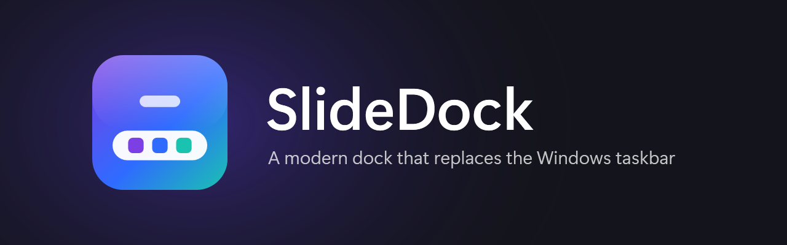

# SlideDock

A modern dock that replaces the Windows 10/11 taskbar. Single C# file, built with the compiler that already ships with Windows. No installer, no Visual Studio.

<p align="center">
  <a href="https://github.com/hubble99/slidedock-windows/releases/latest/download/SlideDock.exe"></a>
  <a href="https://github.com/hubble99/slidedock-windows/releases/latest"></a>
</p>

## Download

Click **Download SlideDock.exe** above (or [download it here](https://github.com/hubble99/slidedock-windows/releases/latest/download/SlideDock.exe)): it always gets the newest version. You can also pick a file from the [latest release](https://github.com/hubble99/slidedock-windows/releases/latest). Put it in a folder you keep (for example `Documents\SlideDock`) and double-click it.

The first time, Windows SmartScreen may say "Windows protected your PC" because the app isn't code-signed yet: click **More info → Run anyway**.

## Updates

SlideDock checks GitHub for a new release shortly after it starts and every 6 hours. When there is one:

- a Windows notification appears (click it to update),
- a blue dot shows on the dock's Start button, and Start shows **Update**.

Updating downloads the new `SlideDock.exe`, checks its SHA-256 checksum, swaps the file and restarts the dock. You can also check by hand in **Start → Dock settings → Updates**, or turn automatic checks off there. The Microsoft Store version is updated by the Store instead.

## Features

- **Dock** with pinned and running apps, live window previews (hover), magnify on hover. Drag a pinned icon left or right (up or down on a side dock) to change the order
- **Drag files into apps**: drag a file from Explorer onto an app icon (dock or notch), then hold it over a window preview; that window comes to the front so you can drop the file into it (e.g. WhatsApp Web, upload forms)
- **Notch mode**: shrinks to a small pill when idle. When the mouse comes near, the notch stretches out a little like a loading bar and only opens the full dock if the mouse stays. Clicking an empty part of the notch opens the dock right away. App icons in the notch work like the dock: hover for window previews, click to switch
- **Start**: your chosen apps (drag an icon to a new spot; the other icons slide aside to make room), clock, Wi‑Fi/battery/disk info, background (tray) apps, PC settings, Dock settings, Task Manager, power buttons (update-aware Restart/Shut down)
- **Search** for apps, files and the web
- **Status icons**: Wi‑Fi, volume and a battery ring (blue bolt while charging); each icon opens its own panel (Wi‑Fi list, volume, battery), scroll on the volume icon to change volume
- **Quick Settings**: brightness, volume, Wi‑Fi list and connect, Bluetooth on/off with paired and nearby devices (pair, connect or disconnect headphones and speakers, remove)
- **Calendar + notifications** (dismiss one or clear all). Click a date to see that day: public holidays for your country (taken from Windows *Country or region*, shown as red dates, names in the local language or English), observances, and your Google Calendar events. **Open in Google Calendar** and **+ Event** open that day in your browser
- **Google Calendar (read-only)**: paste your calendar's *Secret address in iCal format* in Dock settings → Calendar. Events show as blue dots and in the day panel; the link is stored encrypted for your Windows account. Works with any iCal link (Outlook, iCloud)
- **Themes**: Glass 1 (dark frosted glass, white text), Glass 2 (bright white frosted glass, black text) or Dark
- **Dock settings** in Start, changes apply right away:
  - **Appearance**: theme, position, dock size (Auto picks a smaller dock on small screens), magnify strength, open-app indicator (line, dot or none), 12- or 24-hour clock, date and battery percentage on the dock, Simple (icon buttons) or Detailed volume and battery panels
  - **Dock behavior**: Floating (floats over apps, can shrink to a notch), Fixed (like the taskbar: maximized apps stop at the dock) or Auto-hide (appears when the pointer touches the screen edge); drag the notch or dock along its edge; hide in fullscreen apps; start with Windows
  - **Dock contents**: pinned and open apps, pinned only or open only; open apps from all screens or only this one; show or hide the Start button, Search, Recycle Bin, Wi-Fi, Volume, Battery and the clock
  - **Interaction**: clicking an open app shows it or also minimizes it, middle-click opens a new window or closes the app, window previews on hover
  - Calendar and updates
- **Position**: bottom, left or right; one dock per monitor, per‑monitor DPI. Popups (Start, calendar, status panels) open next to the dock wherever it is
- **Windows key** always opens SlideDock's Start (except in fullscreen games and presentations). The old Windows taskbar stays hidden while SlideDock runs
- Works in any Windows display language (Wi‑Fi is read through the Windows WLAN API, not command output)

## Requirements

- Windows 10 (1903 or later) or Windows 11
- .NET Framework 4.8 (built into Windows 10 1903+ and Windows 11)

## Run

Double-click `SlideDock.exe`. The Windows taskbar is hidden while SlideDock runs.

**Options**: open Start → **Dock settings** (✎ icon, top right), or right-click the Start button / an empty area of the dock:
- Theme, position, size, magnify, dragging, notch, dock mode, which icons the dock shows
- Start with Windows, on from the first run (creates a Task Scheduler task named "SlideDock" that runs at sign-in, plus a Startup-apps entry as a backup in case the task can't run on that PC)
- Open settings folder
- **Exit SlideDock (restore taskbar)**: closes the dock and brings the normal taskbar back

## Uninstall

Use **Dock settings → More → Uninstall SlideDock** (or right-click the SlideDock tray icon → **Uninstall SlideDock...**). It puts the Windows taskbar back exactly as it was before SlideDock (visible on every monitor, auto-hide and other taskbar settings restored), removes "Start with Windows", then deletes `SlideDock.exe` and `%APPDATA%\SlideDock`. In the Microsoft Store version it restores the taskbar and opens **Installed apps** so you can remove it there.

If you remove the Store version straight from Windows Settings while it's running, SlideDock notices Windows closing it and restores the taskbar too. If you just delete `SlideDock.exe` after shutting Windows down with SlideDock running, the taskbar may stay on auto-hide: turn it off in Settings → Personalization → Taskbar → Taskbar behaviors, or run SlideDock once and use Uninstall.

## Settings

Stored per user in `%APPDATA%\SlideDock` (pinned apps, Start apps, theme, position, `prefs.txt` for the other dock settings). Delete that folder to reset.

If something goes wrong, `startup.log` and `error.log` in that folder say what happened.

## Build

```powershell
powershell -ExecutionPolicy Bypass -File build.ps1            # SlideDock.exe next to the source
powershell -ExecutionPolicy Bypass -File packaging\pack.ps1   # release files + Store .msix in dist\
```

The version comes from the `VERSION` file. The Windows SDK is optional for the app itself (without it the build uses the metadata files that come with Windows); it's needed only for the `.msix`.

Brand assets (icon, Store logos, banner) are generated by `tools\make-assets.ps1`.

## Releasing a new version

1. Change `VERSION` (for example `0.1.0` → `0.1.1`).
2. Commit and push to `main`. Write the summary as `- ` points in the commit message body (indent wrapped lines by two spaces): they become the release notes and SlideDock shows them in Start, Dock settings and the update notification.

GitHub Actions builds the app and publishes the release `v<VERSION>` with `SlideDock.exe`, its checksum and a zip. Installed copies then show the update. Pushes that don't change `VERSION` are only built and kept as workflow artifacts.

## Microsoft Store

Every build also produces `SlideDock-<version>-store.msix` (in the workflow artifact). To publish in the Store:

1. Create a Partner Center account and reserve the name **SlideDock**.
2. From **Product identity**, copy *Package/Identity/Name*, *Package/Identity/Publisher* and *Package/Properties/PublisherDisplayName* into the repository variables `STORE_IDENTITY_NAME`, `STORE_PUBLISHER`, `STORE_PUBLISHER_DISPLAY_NAME` (Settings → Secrets and variables → Actions → Variables), then re-run the workflow.
3. Upload the `.msix` from the artifact in a new submission. The app declares `runFullTrust`, so the submission needs a short explanation (it's a desktop app that replaces the taskbar). Use [PRIVACY.md](PRIVACY.md) as the privacy policy.

The Store version starts with Windows through the package's startup task and gets updates from the Store.

## Notes

- Notifications in the calendar need permission the first time (Windows asks automatically).
- If SlideDock ever crashes, the taskbar is restored on exit; errors are written to `%APPDATA%\SlideDock\error.log`.
